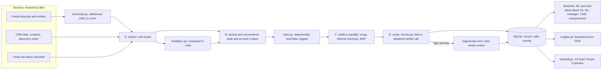

# Debrief

**Synthetic data, fictional company.** Apex, its customers, competitors, playbook and release cards are invented for this prototype.

Debrief covers the window right after an Enterprise technical validation (TV) demo at Apex, where today there is no playbook inside the workflow. It does three jobs:

1. **Close the demo.** A four-line checklist the AE and SC fill before leaving the call: a dated next step the customer agreed, a named stakeholder to add, the customer's own business outcome, and anything the SC promised.
2. **After the demo.** Reads the call transcript and CRM context and produces a call record, at most 3 ranked next steps, and drafts (recap email, internal summary, mutual action plan). Every quote shown is rendered by code from the transcript.
3. **Over time.** Nudges on a business-hours clock, closes the loop back to the SC when a deal moves, and seeds a CS handoff brief from what was captured at TV.

Humans approve everything. Nothing is sent to a customer automatically.

## What is different here

Call recorders and CRMs already offer call summaries, follow-up emails and field updates (verify current vendor features for Gong and Salesforce Agentforce). Debrief includes those for completeness and treats them as commodity. The parts it adds:

- **TV-stage playbook rules.** Each step cites a rule (PB-01 to PB-10) and must be something a typical AE would not do unprompted. Fewer than 3 is normal; padding is never allowed.
- **SC commitment capture and loop closure.** Promises said in passing ("I'll send you our encryption whitepaper") are extracted, flagged when the checklist missed them, tracked with a due date, and closed back to the SC with what mattered.
- **The dismiss-reason diagnostic.** Every step has one-tap dismiss reasons. After 30 days they show which of the 6 candidate causes of post-demo inaction is real.
- **CS handoff seeded from TV evidence.** The champion, stated outcome, objections and answers, open items and MEDDPICC gaps flow to the CSM instead of being lost at handoff.

## How to run

Python 3.11. `pip install -r requirements.txt`.

| Command | What it does | Needs a key |
|---|---|---|
| `make test` | All tests (deterministic, regressions, stress, app walkthrough). Tests never touch the network. | No |
| `make demo` | Streamlit app in replay mode with hand-written sample cards, clearly labelled "Not generated from the call". Never calls the API. | No |
| `make eval` | Scores replay fixtures against gold labels; writes `evals/results.md` and `evals/ablation.md`. Missing fixtures are reported as not run. | No |
| `make record` | Calls the API once per step and saves replay fixtures for all 5 transcripts, plus judge and ablation calls. | Yes |
| `make smoke` | Live API probe; results go to `docs/API_NOTES.md`. | Yes |

Environment: `ANTHROPIC_API_KEY`, `DEBRIEF_MODEL` (default `claude-sonnet-5-5`), `DEBRIEF_MODE` (`live`, `record`, `replay`; default `replay`).

**Current status (be clear about this in a walkthrough).** No API key was available while building, so no model output has been recorded yet. The demo runs on two hand-written sample cards (Halvorsen Freight and Meridian Health). These still go through the real rule and check code, and every screen labels them as samples. Eval scores, cost and latency do not exist yet and are not shown anywhere. After `make record`, the app shows real debriefs instead.

## Data flow

Six model calls per debrief on the normal path. All calls go through `src/llm.py`, which uses `client.messages.parse` with a pydantic schema, logs every call, and reads and writes the replay cache. Details: `docs/API_NOTES.md` and `DECISIONS.md`.

## Diagnosis: why nothing happens after the demo

The scenario packet shows the symptom (days in TV rose 12, 14, 18 over Q1 to Q3 while other stages stayed flat) but not the cause. Win rate falls with days in TV (68%, 41%, 36%), but that is correlational and may run in reverse: weak deals stall and also lose. So Debrief is a diagnostic as well as a helper.

| Candidate cause | Packet evidence for it | How Debrief tells it apart |
|---|---|---|
| (a) AE does not know the next step | A follow-up guide exists in Confluence and AEs do not use it | Steps marked acted on vs ignored. "Already done" dismisses are evidence against (a) |
| (b) AE is waiting on the customer | A manager: "I don't know what they're waiting for" | "Waiting on customer" dismisses, and deals where the call record shows a customer-owned dependency |
| (c) AE has no capacity | Middle and bottom cohorts touch 1.1 and 0.7 times in 14 days vs 2.3 | "No time" dismisses |
| (d) Nobody inspects the post-demo window | No structured SC record (about 60% completion), nothing flows to post-sales | Cards never opened; checklist not filled before the call ends; manager prompts not used |
| (e) Weak commercial judgment after TV | Top reps book the next step before leaving the room | Steps accepted but no customer touch within 3 days; checklist dated next step missing or not supported by the call |
| (f) The deal is weak, nothing to do | Slow deals become hard onboards (r = 0.71, correlation only) | "Not relevant" dismisses, and low-information calls |

**Pre-declared rule:** a cause counts as real only if it explains at least 30% of non-actions with at least 20 events. The close-the-demo checklist adds a second lens: whether a dated next step was agreed before the call ended separates "did not know" from "knew but did not get it agreed".

## Measurement

Every formula lives in `src/metrics.py` with a docstring. The measurement tab shows this session's events next to a seeded simulator, labelled "synthetic example data" everywhere.

- **30 days, adoption:**
  - debriefs per eligible demo;
  - card opened within 24 hours;
  - checklist filled before the call ends;
  - recap sent within 24 hours;
  - SC record confirmed within 1 business day (against today's 60% SC summary completion);
  - drafts sent with an edit ratio under 0.3;
  - steps acted on vs dismissed vs ignored.
- **30 days, diagnostic:** dismiss reasons and ignore behaviour mapped to the 6 causes, using the rule above.
- **30 days, leading impact (headline):**
  - customer-confirmed dated next step within 2 business days;
  - reply rate to the recap within 5 business days.

  Secondary: touches in 14 days for the middle and bottom cohorts vs 1.1 and 0.7, and hours from demo to first touch.
- **90 days, impact:**
  - Days in TV per arm, as a Kaplan-Meier median with open deals right-censored (hand-rolled, tested against a hand-computed censored case).
  - Arms come from a staggered rollout by pod: treated vs not-yet-treated pods in the same calendar weeks, matched on segment, deal size band and AE tenure.
  - Win rate by TV band is descriptive only, labelled "correlational; underpowered at 90 days".
  - Time to first value is compared for Debrief deals vs matched deals.
- **Decision table:** metric, baseline, scale if, fix if, stop if, current value. All thresholds are proposed, to agree with sales leadership.

**Pitfalls:**
- Early adopters are the best reps.
- Touch counts can be gamed.
- Novelty fades.
- Quarter-end seasonality.
- Contamination through shared Slack channels between treated and untreated pods.
- Win rate is a 2 to 3 quarter outcome, not a 90 day one.

No metric target is ever shown as a result, and nothing here claims causation.

## What breaks first, and the signal for each

| What breaks | Event signal |
|---|---|
| Reps stop opening the card (wrong channel or timing) | `card_ignored_24h` rising; `card_opened` latency |
| Steps feel generic, so reps dismiss them | `step_dismissed` with reason `not_relevant` above the agreed rate |
| Checks flag good drafts, so too many rewrites and "needs review" | `verifier_flagged` and `rule_override_applied` per debrief; drafts approved unedited after a flag |
| Drafts need heavy editing | `draft_edited` edit ratio trend; `draft_sent_unedited` share |
| Nudges become noise | `nudge_sent` without `nudge_acted_on` |
| SC stops confirming the record | `record_confirmed_by_sc` within 1 business day falling toward the 60% baseline |
| Transcript format or CRM fields change upstream | Parse errors and `evidence_resolves` failures in `llm_calls` and checks |
| Model behaviour changes on a model or SDK update | Eval pass rates and the smoke test (`make smoke`) on every bump |

## Cost and latency

**Not observed yet.** No live run has happened, so there is no measured cost per debrief, latency or cache hit rate. When there is, `llm_calls` will hold per-call tokens, cache reads, latency and cost; the card footer will show cost per debrief, and `evals/results.md` will list them per deal. Pricing constants are in `src/config.py` (Sonnet 5.5: $2 input and $10 output per million tokens; cache write assumed at 1.25x and to be verified).

## Production path

- **Transcripts:** the Gong REST API for call metadata and raw transcripts. The Gong MCP server is read-only and does not return raw transcripts.
- **CRM:** Salesforce Hosted MCP for opportunity, contacts and activity; checklist fields written back as opportunity fields.
- **Delivery:** Slack MCP or a Bolt app posting the Block Kit card (`assets/ae_card_blockkit.json` shows the format), with interactive buttons calling back into the event log.
- **Consent:** inherited from the call recorder. If Gong did not record the call with consent, Debrief has no transcript.
- **Retention:** keep transcripts and prompts for the Gong retention window or shorter. Keep structured records with the opportunity.
- **Redaction:** PERSON, EMAIL_ADDRESS and PHONE_NUMBER are redacted from logged prompts and outputs when presidio is installed, never from what is sent to the model.
- **Model policy:** refusals are logged and surfaced, never retried on another model (see D-02).

## Known limits and what is mocked

- **Mocked:** Gong, Salesforce and Slack are file-backed adapters (`src/adapters.py`). The calendar invite is a stub. "Mark as sent" is a button, not an email integration. Customer replies are logged by hand in the demo.
- **No live model output yet**, so prompts are unvalidated v1. The two demo cards are hand-written samples.
- **The live API path is unverified:** `docs/API_NOTES.md` lists what was verified offline against the SDK and what still needs `make smoke`. That includes the mid-conversation system message used for caching (D-07).
- **Deterministic checks are heuristics.** The stress test (`evals/stress_report.md`) catches 49 of 61 planted problems with 1 false alarm on 17 clean drafts. That leaves 13 open known-failure tests (12 missed problems plus 1 false alarm), including:
  - an invented name made of ordinary words;
  - some wordings of the superseded hourly sync;
  - generic padding steps;
  - scorers that are looser than the gold labels for T1, T3, X1 and Y1.
- **The LLM judge is uncalibrated** until `data/labels/candidates.csv` is labelled by hand and scored once on the test split.
- **Synthetic data only:** 5 transcripts, written to contain specific traps.
- **Not built:** auto-sending, an agent framework, a battlecard engine and CS forecasting (see DECISIONS.md).

## Demo script: 8 minutes inside a 20 minute walkthrough

**Before you start:** run `make demo` and press Reset demo in the sidebar.

**Minutes 0 to 4: the problem and the diagnosis.** Use the README sections above.
- The symptom: days in TV rose 12, 14, 18.
- The tempting conclusion (win rate by band) is correlational.
- The 6 candidate causes, and why the tool is built to tell them apart.

**Minutes 4 to 12: the demo.**

| Minute | Where | What to do and say |
|---|---|---|
| 4:00 | AE, Halvorsen Freight | Close-the-demo checklist: fill the dated next step and the SC commitment while "in the call". Save. Point out that the business outcome is prefilled from discovery. |
| 5:00 | AE | End the demo. The card appears with state "Ready to advance" and three steps. Point out the sample label and why it is there. |
| 5:30 | AE, step 1 | Toggle "Why this step": the quote and timestamp come from the transcript table, not from the model. The step is something reps miss: briefing the COO who was absent. |
| 6:15 | AE, step 3 | Dismiss with "No time". That one tap is the diagnostic data. Act on step 1 ("Open draft"). |
| 6:45 | Recap tab | Edit one line, Approve and copy, Mark as sent. Edit ratio and approval are logged. Mention that "needs review" disables approve. |
| 7:30 | Other tabs | Internal summary (replaces the 60% SC doc), MAP (only rows with evidence are "agreed"), MEDDPICC (computed in code, "Unknown after TV demo"). |
| 8:15 | Sidebar clock | Move the clock to 170 hours. Priya's partner policy is past due, so the SC reminder fires, inside business hours only. |
| 9:00 | Switch to Meridian Health | End demo, show "Open technical gap". The top step supports the security committee (packet before Oct 9) rather than chasing. Move the clock to 25 hours: the 24 hour reminder fires. |
| 10:00 | AE, Halvorsen | Mark advanced. Switch to SC: the loop closing note says what mattered. Confirm the record in one click. |
| 10:45 | AE then CSM | Mark closed won. CSM view: the handoff brief, Phase 2 preview. |
| 11:15 | Sales manager | Coaching prompts per deal, not a red-flag list. Cohort panel 2.3 / 1.1 / 0.7, with the caveat that touches can reflect deal quality. |
| 11:45 | Measurement | Events from this session, the dismiss breakdown mapped to the 6 causes, and the decision table with thresholds marked as proposals and values marked as synthetic. |

**Minutes 12 to 20: how it is built and how we would know it works.**
- The chain and its guardrails: rules, checks, verifier, replay cache.
- The evals and the planted traps (`python scripts/show_traps.py`).
- The stress test, and what it found and fixed.
- What is still unverified without a key.
- The staggered rollout plan and its pitfalls.
- What breaks first.

## Repository map

`src/`
- `llm.py`: all model calls
- `chain.py`: the 4 stages
- `rules.py`: deterministic overrides
- `checks.py`: deterministic checks
- `transcript.py`: utterance table and quote rendering
- `schemas.py`, `meddpicc.py`, `nudges.py`, `handoff.py`, `events.py`, `metrics.py`, `blockkit.py`, `service.py`, `adapters.py`

`prompts/<step>/v<N>.md`: versioned prompts.

`data/`: transcripts, CRM, Gong activity, playbook, release cards, competitors, gold labels, labels for the judge.

`evals/`: the eval runner, scoring, judge, ablation, stress report.

`tests/`: deterministic, regressions, stress, app walkthrough.

`DECISIONS.md`: every place the AI output was wrong and what changed.
